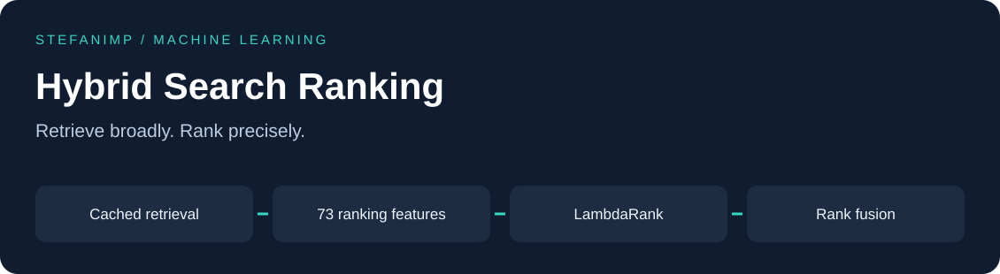

# Hybrid Search Ranking

[](https://github.com/stefanimp/hybrid-search-ranking/actions/workflows/ci.yml)

A passage-ranking pipeline combining dense retrieval, lexical signals, cross-encoder scores
and LightGBM LambdaRank over **100,000 passages**.

**1st place in the University of Jaén information retrieval tournament.**
Final private **MAP@10: 0.63461**. Individual project by [stefanimp](https://github.com/stefanimp).
[Technical report](docs/report.pdf)

## Why this approach

Semantic retrieval finds related passages, but a related passage may still miss the answer.
The ranker combines retrieval scores with term coverage, numeric matches and passage structure.
Reciprocal Rank Fusion then combines its shortlists with complementary rankings.

The archived caches cover the tournament queries. This is a reproducible ranking pipeline,
not a live search service for arbitrary new queries.

## Quick start

Requires Python **3.12 or 3.13** and [uv](https://docs.astral.sh/uv/getting-started/installation/).
Clone the repository and run the synthetic demo:

```bash
git clone https://github.com/stefanimp/hybrid-search-ranking.git
cd hybrid-search-ranking
uv sync --python 3.12 --locked --extra dev
uv run hybrid-search demo
uv run pytest -q
```

The demo combines two synthetic rankings and needs no tournament data. Installation downloads
dependencies. For a standard pip installation, see [reproduction](docs/reproduction.md).

## Reproduce the tournament predictions

Place the original CSVs and five trusted caches under `assets/private/` as described in
[the input contract](docs/reproduction.md#inputs). These artifacts are not distributed in Git.

```bash
uv run hybrid-search check --data-dir assets/private/data --cache-dir assets/private/cache
uv run hybrid-search run --data-dir assets/private/data --cache-dir assets/private/cache --output-dir artifacts/run-001
```

For exact regression comparison, set `PYTHONHASHSEED=0` before starting Python. The commands
for PowerShell and POSIX shells are in the reproduction guide. Each run needs a new or empty
output directory and writes the final CSV plus the trained model. Add `--include-variants`
only when comparing the three historical fusion variants.

## Pipeline


The source separates retrieval, features, grouped datasets, ranking, metrics and I/O.
The final CSV and all three optional variants match the original implementation byte for byte
in the recorded Windows environment. [Verification record](docs/verification.json).

## Results and limits

The final private score was checked against the supplied leaderboard capture,
which is kept offline to protect personal details. The historical public score
of 0.725 concerns a different test subset and is not directly comparable to internal validation.
Internal folds include known relevant documents in their candidate sets, so they measure
ranking under favorable candidate coverage, not complete retrieval quality.

[Design and tradeoffs](docs/design.md) · [Run and reproduce](docs/reproduction.md) ·
[Contribute](CONTRIBUTING.md) · [MIT license](LICENSE)
